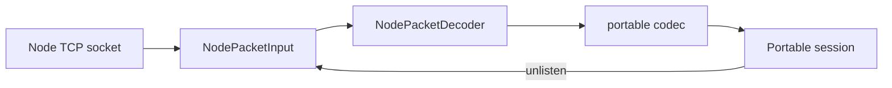

# TCP packet admission

`createTcpClient` accepts `maxPacketBytes` for incoming MQTT packets. It defaults to 1,048,576 bytes and accepts integers from 2 through 268,435,460. The count includes the first byte, the actual Remaining Length encoding and the body. `connect()` rejects invalid configuration before host access or socket creation. A pre-aborted signal keeps its existing precedence.

```ts
import { createTcpClient } from 'mqtt';

const factory = createTcpClient({
  host: '127.0.0.1',
  clientId: 'bounded-input',
  maxPacketBytes: 1024 * 1024,
});
```

Call `factory.connect()` to start a session. Factory construction performs no I/O. The README contains a complete exchange and disconnect example.

This introduces a default limit where the supported TCP adapter previously had none. Configure a larger value for larger incoming packets. The local limit is independent of TCP chunks, outgoing publication size, application queues and negotiated MQTT Maximum Packet Size. It does not advertise that property in CONNECT; negotiation remains under #16. It can reject an otherwise valid packet above the local budget.

## Input and operation outcomes

The decoder checks the first byte itself and reports the early flag and QoS errors that mqtt-packet reported. It collects at most four length bytes, rejects a non-minimal Remaining Length before frame allocation, checks total wire size and copies the admitted remainder into compact owned storage. A declaration above the budget fails without waiting for its body, including a fragmented declaration. The adapter destroys the connection and reports a RangeError with message `MQTT packet allocation limit exceeded`.

Several complete packets can arrive in one chunk. Completed application publications are delivered synchronously before a later packet in that chunk fails. A still-pending connect, subscribe or ping operation fails on fatal input, even when a valid acknowledgment appeared earlier in the same callback. Tests cover CONNACK, SUBACK and PINGRESP prefixes. No artificial microtask delay selects the outcome. Operations already settled in an earlier turn keep their result.

A matching refused CONNACK retires the attempt in the session's receive callback. A trailing close cannot replace its refusal reason code. This ordering belongs to the core and applies to its transports. Rejection of an outstanding publication does not prove that no bytes reached the broker; new writes after retirement are barred, while an earlier write may already have progressed.

Received payloads remain mutable Node Buffers. They retain a compact remainder buffer rather than the entire coalesced socket chunk. Caller mutation of fragmented input cannot alter the copied frame. This does not bound decoded objects, strings, consumer retention, kernel buffers, total heap or process memory. The retained parser still defines the broader Node packet profile; this change does not add public QoS 1/2 support or full protocol conformance.

A payload view can be transferred without detaching the chunk that still contains protocol replies. The regression transfers its backing ArrayBuffer with structuredClone and verifies a coalesced PINGRESP still completes. It uses an in-process transfer, not a worker deployment test. The payload view preserves its byte offset and length; the backing buffer also contains that packet's other fields.

## Terminal ownership



The private input helper owns decoding and terminal notification. It has no socket capability. The adapter interprets native events and performs teardown. One connection attempt installs one core registration; a new attempt needs a new factory.

A decoder error, native error or abort records the real reason before notifying the core. Stopping during an application callback prevents further body allocation in a coalesced suffix. A failure recorded before core registration is replayed synchronously when listening begins. Cleanup returned after that notification remains valid and idempotent.

Core unlisten clears the packet and failure bridges, marks core ownership and stops decoding. The helper has no access to the core's timeout, refusal or disconnect Error. Its private stop reason is therefore hidden and never replaces those outcomes. Concurrent opening cancellation retains the factory's existing abort-precedence policy.

Readable `end` completes incoming MQTT input. Partial header, length or body reports truncation. Completion at a packet boundary retains the ordinary remote-close reason. Physical `close` is a guarded fallback and cannot repeat completion. Earlier error, abort or core-owned retirement prevents a later EOF from replacing the outcome. The readable-end handler also rejects a blocked outgoing write without waiting for native close to drain it.

Native close always releases the signal listener and settles the close promise, including after decoder failure. Terminal input paths can release cancellation earlier, before their rejected operation resumes. Core-owned graceful shutdown retains native cancellation until closure. This is cleanup ownership, not a wall-clock guarantee or a network backpressure policy.

## Evidence and remaining work

The private decoder is exercised by the existing compact/streaming characterization corpus. Public TCP tests cover exact limits, declared excess, acknowledgment prefixes, application prefixes, remote EOF, refusal, abort, timeout, compact Buffer ownership and blocked writes. The cross-platform blocked-write regression holds one stream write completion and triggers EOF through a real peer. It checks queued bytes before EOF rather than assuming a payload will fill every operating system's socket buffers. The installed-tarball probe also exercises an 8 MiB write against a paused peer on Linux. The Mosquitto echo uses an explicit packet limit.

NodePacketAdmission covers frame admission and completion. NodeInputLifecycle separately covers registration replay, first-cause ownership, decoder retirement, remote truncation and completion count. Its late-read property prevents another decoder push call after retirement; it does not claim that bypassing this guard alone defeats the decoder's own failure barriers. ConnectRefusal checks synchronous refusal ownership and preservation of the first terminal cause. Native parsing, exact Error identity, backing storage, physical closure and scheduling remain concrete-test responsibilities. The cancellation model additionally permits signal release after logical retirement.

Node WS/WSS uses the same private decoder and input helper, with [its own native-close semantics](websocket-packet-input.md). Its aggregate WebSocket-message cap remains independent of MQTT assembled across messages. Broader malformed-packet rules, property limits and comparisons remain under #9; queue ordering and soak work remain under #11. The [measurement index](measurements.md) links all recorded observations and their limits.

The shared Node decoder checks inbound PUBLISH topic bytes before handing the compact remainder to the portable codec. It rejects ill-formed UTF-8, U+0000 and a topic field that extends past the frame. The check reads a view of the topic bytes and leaves the binary payload and its Buffer ownership intact. It preserves valid U+FEFF, U+FFFD and supplementary characters. TCP and Node WebSocket retire the connection and preserve the first error. The browser codec already checks these string rules. The public adapter tests run over scripted peers, with the browser adapter using Node's native WebSocket. Property strings and topic alias semantics are separate checks. [MQTT 5 sections 1.5.4 and 3.3.2.1](https://docs.oasis-open.org/mqtt/mqtt/v5.0/os/mqtt-v5.0-os.html)
